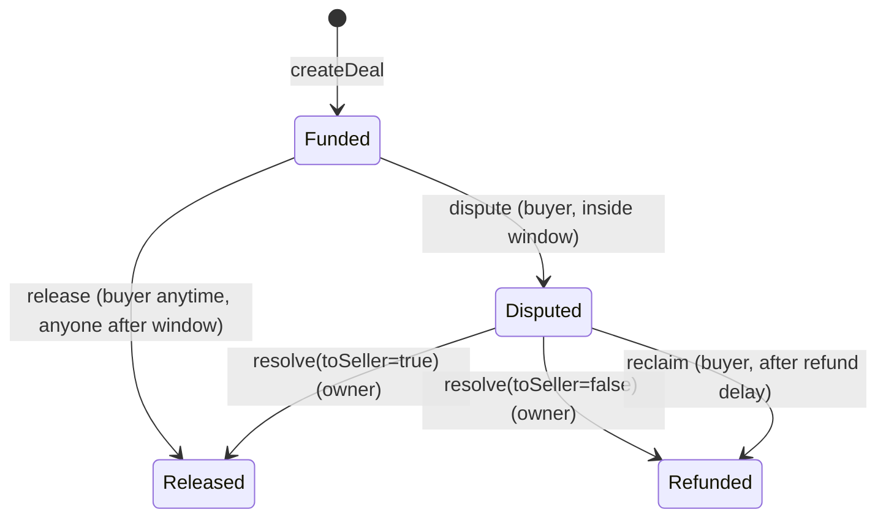

# Escrow: Design Doc

## 1. Metadata

- Status: Draft
- Target chain: Arc Testnet (EVM). Asset: USDC (ERC-20 view, 6 decimals; address read from the app's chain facts, never hardcoded in logic)
- Language / toolchain: Solidity 0.8.28, Foundry, OpenZeppelin 5.x
- Review tracker: [ ] Design  [ ] Security  (Ops, Data, Compliance: N/A for a testnet demo)

## 2. Action Items (living)

- (empty)

## 3. Goals / Non-Goals

Goals
- A buyer locks USDC for a named seller. The seller is paid automatically once a dispute window passes with no dispute.
- The buyer can dispute inside the window. The owner then decides who is paid.
- If the owner does not decide in time, the buyer can take the money back, so funds can never be locked forever.
- A small protocol fee on successful payouts, off (0%) until the owner turns it on.
- Emergency pause controlled by the owner.

Non-Goals
- No upgradeability (immutable contract).
- No per-deal arbiter, no partial releases, no milestones, no native-coin or multi-token support.
- No on-chain proof of delivery. "Delivered" is simply "buyer did not dispute in time".

## 4. Requirements

Functional
- F1 Buyer creates a deal (seller, amount) and USDC is pulled into the contract.
- F2 After `disputeWindow`, anyone can trigger payout to the seller. The buyer can also release early.
- F3 Within `disputeWindow`, only the buyer can dispute.
- F4 Owner resolves a disputed deal: pay seller (fee applies) or refund buyer (no fee).
- F5 If a dispute is unresolved for `refundDelay`, the buyer can reclaim the full amount.
- F6 Owner sets fee (bps, max 5%) and fee recipient. A fee applies only to deals created after it was set.
- F7 Owner can pause and unpause.

Security (testable assertions)
- S1 Each deal pays out exactly once (status machine is one-way out of Funded/Disputed).
- S2 `seller payout + fee + refund == deal amount` for every deal.
- S3 USDC balance of the contract >= sum of open deal amounts + accrued fees at all times (solvency invariant).
- S4 Only the buyer can dispute or reclaim. Only the owner can resolve, set the fee, pause.
- S5 The owner can never take escrowed funds for itself: resolve only pays the buyer or the seller of that deal.
- S6 No path locks funds forever (see failure scenarios).
- S7 Pause blocks new deals and all payouts, but never destroys the buyer's right to dispute.

## 5. Terminology & Actors

- Deal: one escrow between one buyer and one seller.
- Dispute window: time after funding in which the buyer may dispute (default 3 days).
- Refund delay: time after a dispute after which the buyer may reclaim if unresolved (default 14 days).

| Actor | Trust | Can do |
| --- | --- | --- |
| Buyer | untrusted | create, dispute (in window), release early, reclaim (after refund delay) |
| Seller | untrusted | receive payout; nothing else |
| Anyone | untrusted | trigger release after the window; trigger fee withdrawal |
| Owner | trusted (semi) | pause/unpause, set fee, resolve disputes, rescue stray tokens |
| Fee recipient | trusted | receives accrued fees |

## 6. Language / Runtime

Solidity 0.8.28 (checked arithmetic). Base contracts: OpenZeppelin `Ownable2Step`, `Pausable`, `ReentrancyGuard`, `SafeERC20`. `renounceOwnership` is overridden to revert.

## 7. Transaction & Execution Model

Every function is atomic. State is updated before any token transfer (checks-effects-interactions), and every fund-moving function is `nonReentrant`. USDC is a known token, but the code still measures the balance delta on deposit.

## 8. Chain Standards & Interfaces

ERC-20 (USDC) only. On Arc, USDC is also the native gas coin, but the contract uses the ERC-20 view exclusively and accepts no native value (no `receive`/`payable`).

## 9. Architecture Overview

Flow of funds

| Step | Who moves what | Invariant |
| --- | --- | --- |
| createDeal | buyer -> contract: `amount` | received == amount; fee snapshot = amount * feeBps / 10000 |
| release / resolve(true) | contract -> seller: `amount - fee`; fee added to `accruedFees` | payout + fee == amount |
| resolve(false) / reclaim | contract -> buyer: `amount` | refund == amount, no fee |
| withdrawFees | contract -> feeRecipient: `accruedFees` | accruedFees reset to 0 first |

Resting-state invariant: `USDC.balanceOf(this) >= openEscrow + accruedFees` (equal unless someone sends USDC directly).

Dependencies: the USDC token only. No oracle, no external calls besides USDC.

## 10. Contract Design

Roles

| Role | Holder | Permissions | Why |
| --- | --- | --- | --- |
| Owner | one address, two-step transfer | pause, unpause, setFee, resolve, rescue | single admin for a demo; no upgrade power |

Deviation from the "separate Pauser" convention: you asked for pause controlled by the owner, so there is no separate pauser. See threat analysis.

Storage

- `IERC20 immutable usdc`
- `uint64 immutable disputeWindow`, `uint64 immutable refundDelay` (fixed at deploy, bounds-checked)
- `uint16 feeBps` (<= 500), `address feeRecipient`, `uint256 accruedFees`, `uint256 openEscrow`
- `uint64 lastUnpausedAt`
- `uint256 nextDealId`
- `mapping(uint256 => Deal) deals`
- `struct Deal { address buyer; address seller; uint128 amount; uint128 fee; uint64 fundedAt; uint64 disputedAt; Status status; }`
- `enum Status { None, Funded, Disputed, Released, Refunded }`

Constants: `MAX_FEE_BPS = 500`, `UNPAUSE_GRACE = 1 days`.

Write functions

| Function | Caller | State change | Event | Reverts |
| --- | --- | --- | --- | --- |
| `createDeal(address seller, uint256 amount) returns (id)` | anyone | new Funded deal, `openEscrow += amount`, pulls USDC | `DealCreated(id, buyer, seller, amount, fee)` | paused; seller zero or == buyer; amount 0 or > uint128; received != amount |
| `release(id)` | buyer anytime; anyone when `now >= fundedAt + disputeWindow` and `now >= lastUnpausedAt + UNPAUSE_GRACE` | Funded -> Released, pays seller, accrues fee | `DealReleased(id, sellerAmount, fee)` | paused; not Funded; too early for non-buyer |
| `dispute(id)` | buyer | Funded -> Disputed, `disputedAt = now` | `DealDisputed(id)` | not buyer; not Funded; `now >= fundedAt + disputeWindow`. Works while paused |
| `resolve(id, bool toSeller)` | owner | Disputed -> Released or Refunded | `DealResolved(id, toSeller)` plus release/refund event | paused; not owner; not Disputed |
| `reclaim(id)` | buyer | Disputed -> Refunded, pays full amount | `DealRefunded(id, amount)` | paused; not buyer; not Disputed; `now < disputedAt + refundDelay` |
| `setFee(uint16 bps, address recipient)` | owner | updates fee config | `FeeUpdated(bps, recipient)` | bps > 500; recipient zero |
| `withdrawFees()` | anyone | sends `accruedFees` to recipient, zeroes first | `FeesWithdrawn(recipient, amount)` | recipient zero; nothing accrued |
| `pause()` / `unpause()` | owner | toggles; unpause sets `lastUnpausedAt` | OZ `Paused` / `Unpaused` | OZ state checks |
| `rescueToken(token, to, amount)` | owner | for USDC only the surplus above `openEscrow + accruedFees` | `TokenRescued` | amount exceeds rescuable |

Views: `getDeal(id)`, `nextDealId()`, `releasableAt(id)` (earliest time anyone can release), `reclaimableAt(id)`.

Constructor: `(IERC20 usdc, address owner, uint64 disputeWindow, uint64 refundDelay)`. Rejects zero addresses; window and delay must be > 0 and `refundDelay >= 1 minute`. Fee starts at 0 bps with recipient unset.

## 11. Specification tables

N/A. No known baseline spec is implemented beyond using ERC-20.

## 12. Deployment & Initialization

Constructor deploy, no initializer. Genesis owner is your choice (see Tradeoffs). Fee is 0 until the owner calls `setFee`. No post-deploy calls are required for the contract to work.

## 13. Upgradeability

None. Migration story: deploy a new contract, stop creating deals on the old one, and let open deals finish. Open deals on the old contract are never stranded because release, dispute, and reclaim remain available.

## 14. Key Management & Signing

No off-chain signatures. One privileged key (owner). `Ownable2Step` prevents transferring to a wrong address.

## 15. Security Considerations

| Vulnerability | Applicable? | Mitigation |
| --- | --- | --- |
| Reentrancy | Yes, USDC transfers | CEI and `nonReentrant` on all fund movers |
| Access control | Yes | Buyer-only dispute/reclaim, owner-only resolve/fee/pause; checked per deal |
| Overflow | Checked 0.8; amount cast to uint128 is range-checked | No `unchecked` blocks |
| Unchecked external call | Yes | `SafeERC20` everywhere |
| Fee-on-transfer / rebasing | Token is fixed USDC | Balance delta checked on deposit |
| Signature replay | No | N/A, no signatures |
| Front-running / MEV | Low | Seller could race a dispute at the window edge: window is strict (`<`) and only the buyer can dispute; unpause grace stops release-on-unpause sniping |
| Flash loan / oracle | No | No price inputs |
| Denial of service | Yes | Pull-based fees; per-deal independence; no loops. A USDC-blocklisted seller makes `release` revert, but the buyer can dispute and the owner can refund, or the buyer reclaims after the delay |
| Delegatecall / proxy | No | Immutable |
| Timestamp dependence | Yes | Windows are days; validator drift is irrelevant |
| Approval persistence | Yes | App requests the exact deal amount, not unlimited |
| Centralization | Yes | Owner decides disputes. Cannot take funds for itself (S5); worst case is a wrong ruling or a pause |
| Direct USDC transfers to the contract | Yes | Not counted as escrow; only recoverable via `rescueToken` surplus |

## 16. Trust Model & Threat Analysis

| Actor | Worst case if compromised | Mitigation | Detection |
| --- | --- | --- | --- |
| Owner key | Rules every dispute for one side; pauses forever; sets fee to 5% and redirects it to an attacker address (new deals only) | Cannot touch undisputed deals past the window; buyer reclaims 14 days after a dispute even if paused is lifted; fee capped at 5% | `FeeUpdated`, `DealResolved`, `Paused` events |
| Pause stuck on | Payouts blocked while paused | Owner must unpause; this is the accepted cost of an emergency brake | `Paused` event |
| Buyer | Disputes every deal to stall sellers | Accepted for this model; the owner resolves, and each dispute costs the buyer gas | `DealDisputed` |
| Seller | Nothing beyond receiving payout | None needed | N/A |

## 17. Emergency Response & Circuit Breakers

Owner calls `pause()`: new deals, release, resolve, and reclaim all stop. `dispute` stays open so buyers keep their rights. On `unpause()`, release by non-buyers waits an extra 1 day so buyers can react. Stray tokens are recoverable with `rescueToken`, and escrowed USDC is never rescuable.

## 18. Failure Scenarios

- Owner key lost: undisputed deals still pay out. Disputed deals are reclaimed by the buyer after 14 days. Only fees and pause control are lost.
- Seller blocklisted by USDC: `release` reverts; the buyer disputes and either the owner refunds or the buyer reclaims after the delay.
- Buyer blocklisted by USDC: refunds revert; the owner resolves in favor of the seller, or the funds wait until the blocklist clears.
- Fee recipient blocklisted: only `withdrawFees` reverts. Payouts are unaffected because fees are accrued, not pushed.
- Contract paused for a long time: funds are held, not lost. Dispute is still available.

## 19. Priorities & Tradeoffs

| Decision | Tradeoff | Rationale / rejected alternative |
| --- | --- | --- |
| Reclaim applies only to disputed deals | A buyer who never disputes cannot get a refund | If a buyer could reclaim any funded deal after 14 days, it would race the seller's auto-release after 3 days and make the payout unreliable. Rejected |
| Owner resolves disputes | Centralized | You chose this. Per-deal arbiter rejected for simplicity |
| Fee snapshot at creation | Fee changes do not affect open deals | Predictable for buyers and sellers |
| Pull-based fee withdrawal | One extra call | Prevents a bad recipient from blocking payouts |
| Windows are deploy-time immutables | Cannot be tuned later | "Fixed global" per your answer, and lets a demo deploy use short windows |
| Pause lacks a separate pauser | One key has more power | You asked for owner-controlled pause |

## 20. Testing Strategy

Foundry: happy path, every revert, events, status machine (no double payout), fee math fuzz (payout + fee == amount), time boundaries at exactly the window and delay, pause behavior, unpause grace, rescue limits, two-step ownership, and an invariant test for solvency (S3). Run: `forge test`. Slither runs as part of the review.

## 21. Third-party libraries

| Lib | Version | Existing dependency | Why |
| --- | --- | --- | --- |
| OpenZeppelin Contracts | as installed in the project | Yes | Audited Ownable2Step, Pausable, ReentrancyGuard, SafeERC20 |

## 22. Monitoring & Alerting

Watch `DealDisputed` (info), `DealResolved` (info), `Paused` (high), `FeeUpdated` (high), `TokenRescued` (high).

## 23. Cross-Functional Stakeholders

Design and security reviewers only. Ops, data, and compliance are N/A for a testnet demo.

## 24. Message Encoding

N/A. No cross-chain messaging.

## 25. Types & Enums

See storage: `Deal` and `Status`.

## 26. Worked Example

Alice (buyer) approves 100 USDC and calls `createDeal(bob, 100e6)` with fee 1%: deal 0 is Funded, fee = 1e6. Three days pass with no dispute. Anyone calls `release(0)`: Bob receives 99 USDC and 1 USDC accrues. `withdrawFees()` sends it to the fee recipient.

Dispute path: Alice calls `dispute(0)` on day 2. The owner calls `resolve(0, false)` and Alice gets 100 USDC back. If the owner does nothing for 14 days, Alice calls `reclaim(0)`.

## App (frontend) scope

Connect wallet, approve-and-create form, a "my deals" list for buyer and seller with live countdowns and the right action button per role (dispute, release, reclaim), and an owner panel (pause, fee, resolve) that is active only for the owner wallet.
